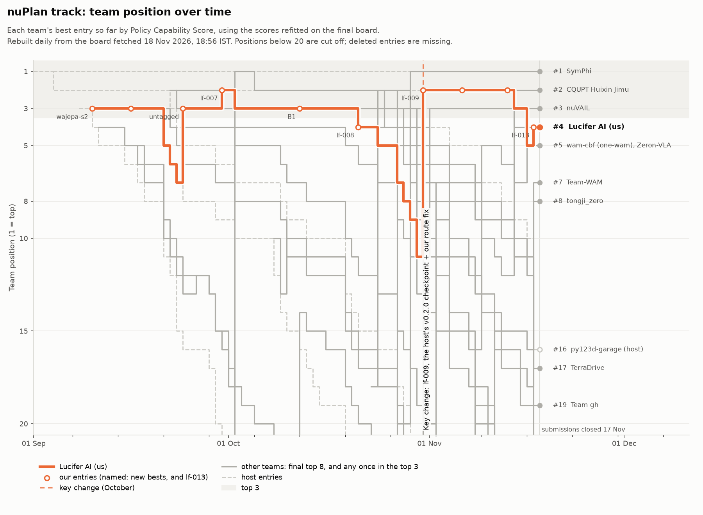

Team Lucifer AI entered the nuPlan track of the AlpaSim E2E Closed Loop Challenge 2026. Here a driving policy is scored by driving: it sees rendered camera images and plans a path, and a simulator follows that path on 10 recordings that were never released.

Our last entry, lf-013, is our best by score: mean scene score 0.9494 and Policy Capability Score (PCS) 2502 on the final public board (18 November, with every entry scored), with 1.36 km between at-fault incidents against 1.04 for our previous best, lf-009. That is the **4th-highest Policy Capability Score of the 57 participating teams** on the public leaderboard (the board's 63 accounts include six host accounts). The board's own rank column, which orders entries by the pessimistic end of each score's range, put us 9th in that snapshot; in a refit later that evening (20:11 IST, 291 entries) lf-013 had PCS 2528 and we were 4th in both orderings. Final standings use a private evaluation set and may differ.

Both entries run the host's public Latent TransFuser checkpoint from py123d_garage, and our changes are at inference. lf-009 places the model's 40, 60 and 80 m route targets along the route itself, not at straight-line distances, which misplaced them on bends. lf-013 adds a safety veto that changes the path only on bends where the plan would leave the road.

## What we learned

- **Start from the strongest public baseline.** Two months of other models and our own training peaked at PCS 1680. The host's improved checkpoint with our route fix reached 2487, and 2502 with the bend veto.
- **Most local gains did not transfer.** lf-010 and lf-012 each raised our mean on 1,472 public scenes by 0.015 to 0.017, yet both scored lower PCS than lf-009 on the hidden recordings. lf-013, the smallest change, was the only one that carried over.
- **Mean score is not the leaderboard.** lf-012 beat lf-009 on mean score and on distance per incident, yet scored lower PCS. PCS models perfect, partial and failed scenes separately, so the mean alone does not predict it.
- **The top of the board is noisy.** With no new entry from us, our team moved from 4th to 8th within an hour on 17 November, as other entries arrived and scores were refitted. Board order also uses the pessimistic end of each score's range, so lf-013 sits just below lf-009 despite its higher PCS.

## Our position over time

Ordered by each team's best PCS and rebuilt with the final board's scores, our best entry held a top-3 place for most of October and the first two weeks of November. Other teams' late entries pushed it to 5th in the last days, and lf-013, our final entry, brought it back to 4th.

## Our entries

Ten official entries took our board score from PCS 863 to 2502. The biggest jump came in late October, when the host released a stronger public checkpoint and we fixed how it reads its route.

| Date | Entry | What it was | Mean scene score | PCS on 18 Nov |
| --- | --- | --- | --- | --- |
| 10 Sep | wajepa-s2 | WA-JEPA world-action model, two flow steps | 0.7678 | 1149 |
| 16 Sep | vavam-stock | Stock VaVAM-B video-action model | 0.5580 | 863 |
| 24 Sep | untagged | Public Latent TransFuser checkpoint `model_0014` | 0.8519 | 1501 |
| 30 Sep | lf-007 | `model_0014` with a route bridge and plan scale 1.25 | 0.8820 | 1568 |
| 12 Oct | B1 | `model_0014` with a fine-tuned planning head | 0.8767 | 1607 |
| 21 Oct | lf-008 | Full-model training on about 622,000 samples, exact route targets | 0.8931 | 1680 |
| 30 Oct | lf-009 | Host's v0.2.0 waypoint checkpoint (seed 1), exact-arc route targets | 0.9454 | 2487 |
| 6 Nov | lf-010 | SimScale decoder fine-tune, sampling fallback, lead rule | 0.9433 | 2367 |
| 13 Nov | lf-012 | lf-009 weights, lead rule, bend veto at 5° | 0.9462 | 2412 |
| 17 Nov | lf-013 | lf-009 weights, bend veto at 10° | 0.9494 | 2502 |

PCS values come from one leaderboard snapshot (the final public board, 18 Nov, 18:56 IST), because the score is refitted as entries arrive. For reference, the host's own entry with the same v0.2.0 checkpoint has mean 0.9437 and PCS 2451.

## Technical report

The full report, *Lucifer-LTF: Route-Aligned Inference and Conservative Adaptation for the AlpaSim Challenge*, covers the method, each entry and the experiment history. This version was updated on 18 November with lf-013 and the final public board, and reorganised on 19 November into standard paper sections (introduction, related work, method, results, limitations, conclusion) with the same numbers. The challenge received an earlier version on 13 November, before lf-013.

  <object data="/assets/posts/alpasim-challenge/lucifer_ai_report.pdf#view=FitH" type="application/pdf" aria-label="Lucifer AI technical report (PDF)">
    
Your browser can't show the PDF here. <a href="/assets/posts/alpasim-challenge/lucifer_ai_report.pdf">Open the report (PDF, 20 pages)</a>.

  </object>

  <a href="/assets/posts/alpasim-challenge/lucifer_ai_report.pdf" target="_blank" rel="noopener">Open in a new tab</a>
  &middot;
  <a href="/assets/posts/alpasim-challenge/lucifer_ai_report.pdf" download>Download PDF</a>

Thanks to the organisers, and to the py123d_garage team for the public baseline we built on.

## Links

- [Technical report (PDF)](/assets/posts/alpasim-challenge/lucifer_ai_report.pdf)
- [Code on GitHub](https://github.com/skr3178/alpasim-e2e-challenge-2026-lucifer-ai)
- [Checkpoint on Hugging Face](https://huggingface.co/skr3178/alpasim-e2e-challenge-2026-lucifer-ai) (an unmodified copy of the py123d_garage checkpoint our entries ran, so the build still works if the original moves)
- [Challenge page](https://huggingface.co/spaces/nvidia/AlpasimE2EClosedLoopChallenge2026)
- [AlpaSim simulator](https://github.com/NVlabs/alpasim)
- [py123d_garage, the base model and driver](https://github.com/kesai-labs/py123d_garage)
- [Pretrained checkpoints](https://huggingface.co/kesai-labs/py123d_garage_pretrained_checkpoints)
